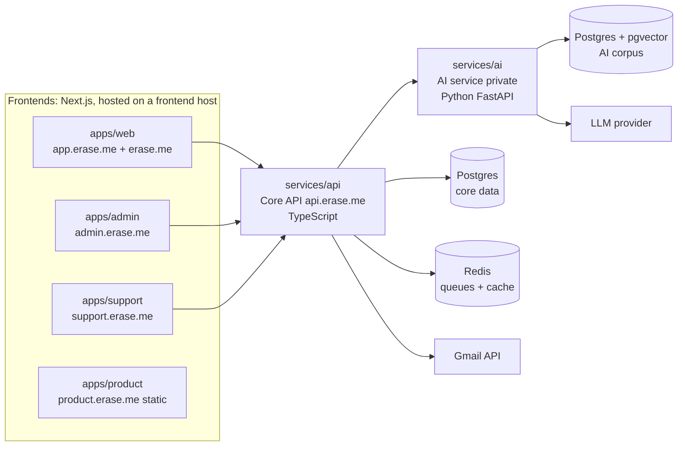

# Erase.me — Technical Requirements Document (TRD)

Version 1.0 · 2026-11-20 · Owner: Navodya
Read with `docs/product/PRD.md`. Feature IDs (F1…F13) refer to the PRD.
**[ASSUMPTION]** marks a proposal to confirm. **[OPEN]** marks an unresolved question.

---

## 1. Goals and constraints

- Five surfaces with separate frontends: app, admin, support (help center), product, plus the marketing landing.
- One core backend API shared by app, admin and the help center's ticket features.
- AI is a separate service, called only by the core API.
- Backend and AI are hosted separately from the frontends.
- Solo build. Prefer boring, well-documented tools. Everything testable and reproducible locally with Docker.
- Privacy first: minimum data, no email bodies stored, strict access control and audit.

## 2. Architecture overview



Rules:
1. Frontends call only the core API (through `@erase/api-client`). They never call the AI service or Gmail.
2. The core API owns the database, Gmail tokens, business rules, auth and audit.
3. The AI service is private (no public URL). It receives minimal inputs from the core API, returns structured outputs, keeps no personal data, and never reads the core database.
4. product.erase.me is static: no backend, no cookies shared with other surfaces.
5. Gmail tokens never leave the core API.

## 3. Repository (monorepo)

pnpm workspaces + Turborepo. Layout already scaffolded:

```
apps/{web,admin,support,product}
services/api        TypeScript core API
services/ai         Python AI service
packages/{contracts,ui,api-client,config}
infra/{docker,terraform}  scripts/  docs/  .github/
```

- Node 22 (see `.nvmrc`; Vitest 5 needs 22.12 or newer), pnpm 9, Python 3.12.
- One lockfile per ecosystem. Conventional Commits. Trunk-based with short branches and PRs. CODEOWNERS enforced.
- Each app and service has its own `package.json`/`pyproject.toml`, README, tests and env schema.

## 4. Technology choices

| Area | Choice | Why |
| --- | --- | --- |
| Frontends | Next.js (App Router), React, TypeScript strict | One framework for 4 apps, static + server rendering, shared components |
| Styling | Tailwind CSS with design tokens from `packages/ui`; Inter font | Matches design system, fast iteration |
| Components | Radix UI primitives + own components in `packages/ui` | Accessible by default |
| Data fetching | `@erase/api-client` (generated from OpenAPI) + TanStack Query | Typed, cached |
| Forms/validation | React Hook Form + Zod | Shared schemas |
| Core API | Node 22, TypeScript, **Fastify**, Zod, `zod-to-openapi` **[ASSUMPTION]** | Fast, typed, schema-first; the user confirmed TypeScript is acceptable via the scaffold |
| ORM/migrations | Drizzle ORM + SQL migrations **[ASSUMPTION]** (Prisma is an acceptable alternative) | Close to SQL, simple |
| Database | PostgreSQL 16 | Relational data, row-level controls |
| Queue/jobs | Redis + BullMQ | Scans, sends, follow-ups, retries |
| AI service | Python 3.12, FastAPI, Pydantic v2 | Ecosystem for LLM, RAG, MCP |
| LLM | Provider-agnostic wrapper; default Anthropic Claude **[ASSUMPTION]** | Tool use, structured output |
| RAG store | Postgres + pgvector, separate database owned by the AI service | One less moving part |
| Embeddings | Provider embedding model behind an interface **[OPEN]** which model | Swappable |
| MCP | Python MCP SDK; Gmail MCP server and a Calendar/Drive stub in `services/ai/app/mcp` | Demonstrates MCP connectors |
| Auth (users) | Google OIDC sign-in; server sessions in secure cookies | Simple, safe |
| Auth (admin) | Google Workspace/SSO + TOTP 2FA + IP allowlist; separate session cookie | Stronger boundary |
| Observability | OpenTelemetry, structured JSON logs (no PII), Sentry | Standard |
| Testing | Vitest, Playwright, Supertest, pytest, Evals harness | Pyramid |
| CI/CD | GitHub Actions; preview deployments for frontends | Already scaffolded |
| Mobile | PWA only (no Flutter, no native apps) | One codebase, no app-store dependency |
| Hosting | Frontends: a Next.js host (for example Vercel). API + AI: a container host (for example Render, Railway or Fly.io). Managed Postgres and Redis next to the API | Separate hosting as required. Vendor choice **[OPEN]** |

## 5. Domains and environments

| Host | Serves | Notes |
| --- | --- | --- |
| erase.me | Landing | apps/web public routes |
| app.erase.me | User app | apps/web authenticated routes |
| admin.erase.me | Admin | Separate cookies (host-only), IP allowlist |
| support.erase.me | Help center | Static docs + signed-in ticket pages |
| product.erase.me | Product site | Static |
| api.erase.me | Core API | CORS allow-list of the four origins above |
| (private) ai.internal | AI service | Not publicly routable; service token or private network |

Environments: `local` (Docker Compose), `staging`, `production`. Separate Google OAuth clients, databases, secrets and LLM keys per environment.

## 6. Core API (services/api)

### 6.1 Module structure
`src/modules/<module>/{controller, service, repository, schema, tests}`. No business logic in controllers. Repositories are the only code that touches the DB.

Modules: `auth`, `gmail`, `companies`, `requests`, `tracker`, `money`, `kyc`, `aliases`, `registry`, `audit`, plus `tickets` and `admin` (to add). Shared: `common` (errors, pagination, ids), `config` (validated env), `db`, `jobs`, `clients/ai`.

### 6.2 API conventions
- REST, JSON, versioned under `/v1`. OpenAPI 3.1 generated from Zod schemas into `services/api/openapi/openapi.json`; `packages/contracts` and `packages/api-client` are generated from it in CI (fail CI on drift).
- Auth via session cookie; CSRF token for state-changing requests; `SameSite=Lax`, `Secure`, `HttpOnly`, domain `.erase.me` for user session only (admin session is host-only on `admin.erase.me`).
- IDs: prefixed ULIDs (`usr_`, `req_`, `cmp_`, `tkt_`).
- Errors: RFC 9457 problem details with stable `code` values.
- Pagination: cursor-based. Idempotency keys on POSTs that send or create (`Idempotency-Key`).
- Rate limits per IP and per user; stricter on auth and send.
- Every admin read of personal data writes an audit entry before returning data.

### 6.3 Endpoints (v1 outline)

Auth and account
- `GET /v1/auth/google/start`, `GET /v1/auth/google/callback`
- `POST /v1/auth/logout`, `GET /v1/me`, `DELETE /v1/me` (account deletion, F1)

Inboxes and scans (F1, F2)
- `GET /v1/inboxes`, `POST /v1/inboxes/connect/start`, `GET /v1/inboxes/connect/callback`, `DELETE /v1/inboxes/{id}` (disconnect)
- `POST /v1/inboxes/{id}/scan`, `GET /v1/inboxes/{id}/scan` (status and progress; SSE `/v1/inboxes/{id}/scan/events` optional)

Companies (F2, F5)
- `GET /v1/companies` (user's detected companies, filters: category, risk, status)
- `PATCH /v1/companies/{id}` (mark not mine, merge, set category)
- `GET /v1/companies/{id}`

Requests and tracker (F6, F7)
- `POST /v1/requests/drafts` (generate drafts for selected companies)
- `GET /v1/requests`, `GET /v1/requests/{id}`
- `PATCH /v1/requests/{id}/draft` (edit)
- `POST /v1/requests/{id}/approve` (records approval with draft hash)
- `POST /v1/requests/{id}/send`
- `POST /v1/requests/{id}/followup` (create follow-up draft)
- `GET /v1/requests/{id}/proof-pack` (PDF)

Money and exposure (F4, F5; deferred)
- `GET /v1/money/summary`, `GET /v1/money/subscriptions`
- `GET /v1/exposure/summary`, `GET /v1/exposure/companies`

Registry (F9)
- `GET /v1/registry/leaderboard?sort=best|slowest|never` (public, cached; enforces 10-request rule)
- `GET /v1/registry/companies/{slug}` (public aggregate only; includes sample size, date range, methodology version, published company statement)
- `GET /v1/registry/methodology` (current and past versions)
- `POST /v1/registry/corrections` (company or visitor reports an error; rate limited)
- `POST /v1/registry/companies/{slug}/claim` (verified work email, then statement submission)

Overview (F3)
- `GET /v1/overview`

Tickets (F12)
- `POST /v1/tickets`, `GET /v1/tickets`, `GET /v1/tickets/{id}`, `POST /v1/tickets/{id}/messages`

Admin (F11) — under `/v1/admin`, separate auth
- `GET /v1/admin/overview`
- `GET /v1/admin/requests`, `PATCH /v1/admin/requests/{id}/label` (confirm/change label), `POST /v1/admin/requests/followups/send`
- `GET /v1/admin/tickets`, `GET /v1/admin/tickets/{id}`, `POST /v1/admin/tickets/{id}/reply`, `PATCH /v1/admin/tickets/{id}` (assign/solve)
- `GET /v1/admin/companies`, `POST /v1/admin/companies`, `PATCH /v1/admin/companies/{id}` (contact, verification)
- `GET /v1/admin/users` (masked), `POST /v1/admin/users/{id}/reveal` (requires `reason`, returns time-boxed data, writes audit)
- `GET /v1/admin/registry/corrections`, `PATCH /v1/admin/registry/corrections/{id}`, `PATCH /v1/admin/registry/statements/{id}` (publish/remove)
- `GET /v1/admin/audit`, `GET /v1/admin/audit/export`
- `GET /v1/admin/health`

### 6.4 Data model (PostgreSQL)

Naming: snake_case, `created_at`/`updated_at`, soft delete only where stated.

```
users(id, google_sub UNIQUE, email, name, status, created_at, deleted_at)
inboxes(id, user_id FK, email, provider='gmail', status[connected|disconnected|error],
        token_ciphertext, token_key_id, scopes, connected_at, disconnected_at, last_scan_at)
scans(id, inbox_id FK, status[queued|running|done|failed], progress_pct, found_count,
      started_at, finished_at, cursor, error_code)
companies(id, slug UNIQUE, name, domains[], category, grievance_email, grievance_source,
          grievance_verified_at, grievance_status[unknown|verified|bounced], cancel_url,
          must_keep bool, created_at)
user_companies(id, user_id FK, company_id FK, inbox_id FK, first_seen, last_seen,
               signal_types[], risk_level, holds_hint[] , status[active|not_mine|requested],
               UNIQUE(user_id, company_id))
subscriptions(id, user_company_id FK, billing_period, amount_minor, currency, next_renewal,
              looks_unused bool, evidence jsonb)               -- deferred (F4)
requests(id, user_id FK, user_company_id FK, status, thread_id, sent_at, due_at,
         day30_followup_at, created_at,
         sent_message_id, sent_rfc_message_id, channel[email|web_form],
         reply_checked_at, reply_check_failures, first_reply_at)       -- Phase 2 additions
request_replies(id, request_id FK, gmail_message_id, received_at, sender_domain,
                sender_match[company|other|unknown], automatic bool, created_at)
                                                                -- Phase 2: metadata only, never text, subject or address
request_drafts(id, request_id FK, version, to_email, subject, body, draft_hash,
               created_by[ai|user], created_at)
request_events(id, request_id FK, type[drafted|edited|approved|sent|bounced|reply_label|
               followup_drafted|closed], actor_type[user|system|admin], actor_id, payload jsonb,
               created_at)                                      -- append-only
reply_labels(id, request_id FK, label[deleted|info_requested|refused|other], confidence,
             signals[], source[model|admin], confirmed_by, created_at)
aliases(id, user_id FK, company_id FK, address UNIQUE, status)  -- deferred (F8)
alias_messages(id, alias_id FK, received_at, sender_domain, spam_flag)  -- deferred
tickets(id, user_id FK, topic, subject, status[open|waiting_user|solved], assignee_id,
        request_id NULL, created_at, solved_at)
ticket_messages(id, ticket_id FK, author_type[user|admin], author_id, body, created_at)
admin_users(id, email, role[owner|operator|support], totp_secret_ciphertext, active)
audit_log(id, at, actor_type, actor_id, role, action, target_type, target_id, reason,
          ip, request_id)                                        -- append-only
registry_stats(company_id PK, methodology_version FK, window_start, window_end, total_requests,
               distinct_users, in_progress_count, excluded_bounced, excluded_cancelled, replied_count,
               honored_count, info_requested_count, refused_retention_count, median_reply_days,
               no_reply_count, refreshed_at)                     -- materialised/refreshed by job
company_statements(id, company_id FK, body, verified_email_domain, status[pending|published|removed],
                   created_at, published_at)                    -- right of reply, shown as company-provided
registry_corrections(id, company_id FK, reported_by_type[company|user|admin], detail, status[open|accepted|rejected],
                     resolution, created_at, resolved_at)
registry_methodology(version PK, effective_from, min_requests, min_distinct_users, window_months,
                     exclusions jsonb, notes)                    -- versioned rules shown on the methodology page
feature_flags(key PK, value jsonb)
```

Constraints and rules
- `request_events` and `audit_log` are append-only: the application role has INSERT/SELECT only; no UPDATE/DELETE.
- A `requests.status` transition is validated in the service layer against the state machine (PRD F7) and recorded as an event.
- `send` requires an `approved` event whose `draft_hash` equals the current draft hash.
- Registry views read `registry_stats` only. Public output requires `total_requests >= min_requests` and `distinct_users >= min_distinct_users` from the active methodology version, rounded percentages, sample size and date range included. Words like compliant/non-compliant/violating/illegal are forbidden in API fields and enums.
- `refresh-registry` recomputes from `request_events` and `reply_labels` so corrections flow through; each run records the methodology version.
- Indexes: `(user_id)` on user-owned tables; `(status, due_at)` on `requests`; `(company_id)`; GIN on `companies.domains`.
- Row-level security **[ASSUMPTION]**: enable RLS on user-owned tables as defence in depth; the API sets `app.user_id` per request.

### 6.5 Background jobs (BullMQ)
| Job | Trigger | Notes |
| --- | --- | --- |
| `scan-inbox` | User connects/rescans | Paginates Gmail, extracts signals, resumable cursor, idempotent upserts |
| `enrich-company` | New company found | Resolve canonical company, category, contact (AI + catalog) |
| `send-request` | User sends | Gmail send, store thread id, handle quota/retry |
| `poll-replies` | Every 15 minutes (`REPLY_POLL_MINUTES`) for requests that are sent, not yet answered and younger than `REPLY_POLL_MAX_AGE_DAYS`; paused for a user whose account is pending deletion (Gmail push via Pub/Sub later) | `threads.get` with headers only (no snippet, no body); record a reply as metadata (message id, time, sender domain, whether automatic). **Phase 2 has no classifier**: the user sets the outcome. |
| `bounce-detect` | With poll-replies | Mark `bounced`, flag company contact |
| `day30-followup` | Daily | Create follow-up drafts and notifications |
| `refresh-registry` | Hourly | Recompute `registry_stats` |
| `purge` | Hourly, under a Postgres advisory lock | Calls the `SECURITY DEFINER` purge functions (the app role has no DELETE): ended sessions and sign-in attempts; disconnected inboxes past `INBOX_RETENTION_DAYS`; accounts past the undo period (`ACCOUNT_PURGE_AFTER_DAYS`), leaving a tombstone row with no personal data; closed requests only if `REQUEST_RETENTION_DAYS` is above 0 (off by default). Each function has fixed SQL, a pinned `search_path`, a batch limit and a dry-run mode, and writes counts only to `job_runs`. Copies of sent requests in the person's own Gmail are never touched. |
| `notify` | Events | Email notifications to user (no personal content) |

All jobs: idempotent, retried with exponential backoff, dead-letter queue, metrics.

### 6.6 Gmail integration
- Library: official Google API client. Tokens encrypted at rest (section 8).
- Scan strategy: list messages in batches using targeted queries (for example `category:updates OR subject:(welcome OR receipt OR invoice OR "verify your")`, plus `list:` header signals), then fetch **metadata only** (`format=metadata`, headers From, Subject, Date, List-Unsubscribe, List-Id). Bodies are not fetched in scan.
- Respect per-user and per-project quotas; exponential backoff on 429/5xx; cap concurrent requests.
- Sending: Gmail `messages.send` with `threadId` and a stable Erase.me label (`Erase.me/Requests`) applied to sent messages; used to find replies.
- Reply polling: `threads.get` with `format=metadata`, a fixed list of `metadataHeaders` and a partial-response `fields` filter, for stored thread ids. **Decision (Phase 2): message text is never fetched at all**, which is stricter than "read in memory and discard". It needs no scope beyond `gmail.readonly` (Google lists `gmail.readonly` among the scopes for `users.threads.get`). The label `Erase.me/Requests` stays skipped (it needs a label or modify scope). The AI classifier (Phase 3) will need the reply text and so will need a new decision, because it contradicts this one.
- Scopes **[ASSUMPTION]**: `openid email profile` for sign-in; `https://www.googleapis.com/auth/gmail.readonly` and `https://www.googleapis.com/auth/gmail.send` for inboxes. The Gmail read scope is a *restricted* scope: public production use needs Google OAuth verification and an annual third-party security assessment. In test mode, up to 100 named test users. Confirm current requirements in Google's documentation before launch.

## 7. AI service (services/ai)

### 7.1 Responsibilities
1. **Extraction**: turn email metadata signals into a canonical company, category and a "likely holds" hint set.
2. **RAG**: retrieve grounded legal context for drafts (DPDP Act text and rules, summaries) and company-specific context (grievance policies where known).
3. **Agent loop**: plan and execute multi-step tasks with tools: draft a request, find a grievance contact, classify a reply, propose a follow-up.
4. **MCP connectors**: expose Gmail (read metadata, read thread, send) as an MCP server consumed by the agent, with the core API as the auth broker. Calendar and Drive connectors are stubs for later.
5. **Evals**: automated evaluation of extraction, drafting and classification quality.

### 7.2 Service interface (called by core API only)
Auth: shared service token (rotating) over a private network; reject anything else.

```
POST /v1/extract/companies      in: [{sender_domain, display_name, subject_hash, headers_signals}]
                                out: [{company_slug|null, name, category, confidence, signals[]}]
POST /v1/draft/erasure          in: {user:{name, email}, company:{name, grievance_email, category,
                                     must_keep}, holds_hint[], locale}
                                out: {to, subject, body, citations[{source, section}], model, prompt_version}
POST /v1/classify/reply         in: {reply_text, request_context:{company, sent_at}}   (text in memory only)
                                out: {label, confidence, signals[]}
POST /v1/contact/find           in: {company_name, domains[]}
                                out: {email|null, source_url|null, confidence}
POST /v1/followup/draft         in: {previous_draft, days_elapsed, reply_label|null}
                                out: {to, subject, body}
GET  /healthz
```

All outputs are validated with Pydantic and returned as structured JSON. Reject and retry once on schema failure; then return a typed error.

### 7.3 RAG design
- **Corpus** (`services/ai/data/corpus`): the DPDP Act 2023 text (Sections 8, 12, 13 at minimum), applicable rules once notified, official guidance, and Erase.me-authored plain-language notes. Each document has `source_url`, `retrieved_at`, `version`.
- **Pipeline**: ingest → chunk by section/heading (≈300–500 tokens, overlap 50) → embed → store in pgvector with metadata → hybrid search (vector + keyword) → rerank → top-k (k=4) with citations.
- **Grounding rule**: any legal claim in a draft must cite a retrieved chunk; if no supporting chunk, omit the claim. Drafts never invent section numbers.
- **Refresh**: `scripts/ingest_corpus.py` is run on demand and in CI to verify the corpus builds; changes to the corpus require a PR.
- **Boundary**: the vector database is owned by the AI service; it holds no user data.

### 7.4 Agent loop
Pattern: single orchestrator, bounded loop (max 6 tool calls), explicit tool schemas, deterministic post-validation.

```
state = {task, context}
repeat up to N:
  action = model.plan(state, tools)
  if action is final -> validate -> return
  result = run_tool(action)    # tools: retrieve_legal_context, lookup_company, find_contact,
                               # build_draft, check_must_keep, classify_text
  state += result
```

Guardrails: no tool can send email or change state (the AI service has no write access; sending is a core API action after user approval); tool inputs and outputs are logged without personal content; prompts are versioned in `services/ai/app/prompts`; timeouts and cost caps per request.

### 7.5 Prompt and output rules
- Drafts: plain, polite, specific; cite Section 12; ask for written confirmation within 30 days; mention the user's name and registered email; never include ID numbers; never threaten; never claim legal outcomes.
- Must keep companies: add a line acknowledging that the company may be required to retain some records and asking it to state which and for how long.
- Classification labels: `deleted`, `info_requested`, `refused`, `other`; include `signals` (for example "confirms erasure", "requests ID proof", "cites legal retention").

### 7.6 Evals (run in CI)
- Datasets in `services/ai/tests/evals/`: ≥ 50 labelled sender samples (extraction), ≥ 30 synthetic and consented real replies (classification), ≥ 20 draft prompts with rubric checks.
- Metrics: extraction precision/recall; classification accuracy and macro-F1; draft rubric pass rate (cites Section 12, includes name/email, no ID numbers, no threats, asks 30 days).
- Gate **[ASSUMPTION]**: fail CI if classification macro-F1 < 0.85 or draft rubric pass rate < 95% on the golden set.
- Store eval reports as CI artifacts.

### 7.7 Privacy in the AI service
- No persistence of request payloads. Logs contain request ids, timings and token counts only.
- Use the provider's zero-retention options where available **[OPEN]**.
- Redact obvious personal data (phone numbers, long digit strings) from any text before sending to the LLM unless required for classification.

## 8. Security

### 8.1 Authentication and sessions
- Users: Google OIDC; server-side sessions stored in Redis/Postgres; rotating session ids; 30-day sliding expiry; revoke on logout/disconnect.
- Admin: SSO + TOTP; sessions 8 hours; IP allowlist at the edge and in the API; separate cookie name and host-only scope.
- All cookies `HttpOnly`, `Secure`, `SameSite=Lax`; CSRF token on mutations; strict CORS allow-list.

### 8.2 Authorisation
- Role-based for admin: `owner` (all), `operator` (requests, companies, users masked), `support` (tickets and masked user lookup).
- Ownership checks on every user resource (`user_id` from session, never from request body).
- Reveal of personal data: `POST /admin/users/{id}/reveal` with mandatory `reason`; returns data valid for 10 minutes; writes audit.

### 8.3 Data protection
- TLS everywhere; HSTS.
- Gmail refresh tokens: envelope encryption (AES-256-GCM, data key wrapped by a KMS-managed key); key id stored with the ciphertext; rotation supported.
- Secrets in the host's secret manager; never in the repo; `.env.example` only.
- Database: encrypted at rest (managed), backups encrypted, point-in-time recovery, restore drills.
- Logs: structured, request-id correlated, **no personal data**; a log scrubber is applied.
- Input validation with Zod/Pydantic at every boundary; output encoding in frontends; Content-Security-Policy; dependency scanning (Dependabot/`pnpm audit`/`pip-audit`); secret scanning in CI.
- Rate limiting and bot protection on auth, scan start, send and ticket creation.

### 8.4 Privacy by design
- Data minimisation: store only fields listed in PRD section 8.
- Purpose limitation: data is used only for the user's own audit and requests, and for anonymised registry counts.
- User rights: account deletion endpoint triggers a deletion job; export of the user's data available **[ASSUMPTION]**.
- Breach process and contact documented in `docs/security/`; Erase.me needs its own privacy policy, terms and grievance contact before any external user.

### 8.5 Threat model highlights (STRIDE, to expand in `docs/security/threat-model.md`)
- Token theft → encryption, scoped tokens, revocation, anomaly alerts.
- Admin abuse → least privilege, masking, reasoned reveal, immutable audit, alerts on bulk reveals.
- Malicious reply content (prompt injection in an email) → classifier prompt treats text as data, structured output only, no tools with side effects, human review for low confidence.
- Spoofed replies → match thread id and sender domain to the company; flag mismatches.
- Abuse of the registry → counts only from approved, sent requests; rate limiting; anomalies reviewed.

## 9. Frontend architecture

Shared
- `packages/ui`: design tokens (CSS variables), primitives (Button, Chip, Card, Table, Tabs, Input, Dialog, Toast), layout (AppShell, Sidebar, TopBar, PublicShell), charts (bar, progress). Storybook for components **[ASSUMPTION]**.
- `packages/api-client`: generated client, error handling, auth refresh.
- `packages/config`: ESLint, Prettier, tsconfig base.

Per app
- App Router; server components for static/SEO pages; client components for interactive parts; route groups `(public)` and `(app)`.
- State: server state via TanStack Query; local UI state with React state; no global store unless needed.
- Accessibility: WCAG 2.2 AA; keyboard navigation; visible focus; status never conveyed by colour alone (every chip has text); `prefers-reduced-motion` honoured.
- Performance: image optimisation, font subsetting (Inter), route-level code splitting, LCP < 2.5 s on mid-range mobile **[target]**.
- Error and empty states for every screen; skeleton loaders for lists; optimistic updates only for safe actions.
- i18n-ready strings (English first) **[ASSUMPTION]**.
- Analytics: privacy-friendly, first-party, no third-party trackers on app/admin/support; product site has none.

### 9.1 PWA (F14)

- **Scope:** `apps/web` (app.erase.me). Other apps are not required to be installable.
- **Manifest:** `app/manifest.ts` (Next.js metadata route) with name, short name, `display: standalone`, `theme_color #2F55F4`, `background_color #F5F6F8`, `start_url /`, `scope /`, icons 192/512 and a maskable 512. Apple touch icon and `apple-mobile-web-app-capable` meta for iPhone.
- **Service worker:** generated with a maintained Next.js-compatible tool (Serwist is the proposed choice **[ASSUMPTION]**, confirm it is current) or a minimal hand-written worker.
  - Precache: the static shell, fonts, icons and an `/offline` page only.
  - Runtime strategy: network-only for `/v1/*` and any authenticated route. No caching of API responses, HTML of authenticated pages, or anything containing personal data.
  - Versioned cache names; old caches deleted on activate; `skipWaiting` only with a visible "Update available" prompt.
  - On logout: message the worker to clear caches, and clear IndexedDB/localStorage keys the app created.
- **Web push** **[ASSUMPTION, later]**: VAPID keys per environment; subscription stored in `push_subscriptions(id, user_id, endpoint, keys_ciphertext, created_at, last_used_at)`; payloads are generic (no personal content); a `notify` job sends push after email; unsubscribe on logout and on 404/410 responses. Opt-in prompt only after the first sent request.
- **iPhone:** in-app install hint (Share → Add to Home Screen) shown once and re-shown at most every 30 days; push requires the installed app.
- **Auth in standalone mode:** use the standard redirect flow; detect standalone (`display-mode: standalone`) and, if the OAuth redirect cannot complete in-app, open the system browser and return via a deep link or a polling "waiting for sign-in" screen. Test on real devices.
- **Headers:** `Service-Worker-Allowed`, correct `Content-Type` for the manifest, CSP that allows the worker script from the same origin.
- **Testing:** Lighthouse PWA audit in CI; Playwright offline test (no personal data shown offline); a logout test that asserts Cache Storage, IndexedDB and localStorage hold no personal data; a manual device checklist for Android Chrome and iPhone Safari before each release.

Landing page animation requirements (F10)
- Scroll-driven animations with CSS `animation-timeline: view()` under `@supports`, content visible by default.
- Sticky stacked cards with `position: sticky` and per-card `top` offsets; collapses to a normal list under 760px.
- Count-up numbers via CSS `@property`; reduced-motion disables all.

Content apps
- `apps/product/content/*` and `apps/support/content/*` use MDX with front matter (`title`, `date`, `type`, `status`). Search via a static index (for example Pagefind) **[ASSUMPTION]**.

## 10. Observability and operations

- Logging: JSON, levels, request id, user id hash (never raw email).
- Metrics: request rate/latency/errors, job success/failure/latency, Gmail API errors and quota, AI latency/cost/tokens, classification confidence distribution, queue depth.
- Tracing: OpenTelemetry across frontend → API → AI.
- Alerts: API error rate, job failures, queue depth, Gmail quota > 80%, AI error rate, unusual admin reveal volume.
- Runbooks in `docs/runbooks/`: Gmail token revoked, queue stuck, bounce spike, AI provider outage, data deletion request.
- SLO targets **[ASSUMPTION]**: API availability 99.5%; p95 API latency < 500 ms (excluding scans); first scan results visible within 60 s of connecting.

## 11. Testing strategy

| Level | Tooling | Scope |
| --- | --- | --- |
| Unit | Vitest, pytest | Services, state machine, hashing, risk rules, wording helpers |
| Integration | Supertest + Testcontainers (Postgres, Redis) | Modules with real DB; Gmail client mocked at HTTP |
| Contract | OpenAPI diff in CI; Pact-style tests for AI service | API ↔ clients, API ↔ AI |
| End to end | Playwright | Core flows (see below); runs against local stack with fake Gmail |
| AI evals | Custom harness | Extraction, classification, drafting (7.6) |
| Accessibility | axe in Playwright | Every screen |
| Visual | Playwright screenshots vs design canvas references **[ASSUMPTION]** | Key screens |
| Security | Semgrep, dependency audit, secret scan | CI |

Core E2E flows: connect inbox → scan → company list; draft → edit → approve → send; reply arrives → label → tracker updates; day-30 follow-up; admin low-confidence review; admin reveal with reason → audit entry; ticket raise → admin reply → user sees it; public leaderboard hides companies under 10 requests.

A **fake Gmail** server (`scripts/fake-gmail`) provides deterministic data for local development and tests.

Coverage targets **[ASSUMPTION]**: 80% lines on services; 100% on the request state machine and the approval/send guard.

## 12. CI/CD and delivery

- GitHub Actions: lint, typecheck, unit, integration, build, e2e (nightly and on main), AI evals, security scans, OpenAPI drift check.
- PR rules: one approving review (self-review checklist while solo), green CI, PR template completed, ADR for architectural changes.
- Deployments: frontends via host preview + production on merge; API and AI via container build, migration step, health check, automatic rollback on failed health.
- Database migrations: forward-only, reviewed, run in CI against a copy of staging schema; expand/contract pattern for breaking changes.
- Feature flags in `feature_flags` for risky features (for example follow-up sending).
- Versioning: Conventional Commits; changelog generated; tags per release.

## 13. Local development

```
cp .env.example .env
make up            # postgres, redis (and later: fake-gmail, mailpit)
pnpm install
pnpm dev           # all apps and API
cd services/ai && uv sync && uv run fastapi dev app/main.py
```
- Seed script `scripts/seed.ts` creates sample companies (clearly fictional), a test user, and example requests.
- All sample data is fictional and labelled.

## 14. Performance and scalability (v1 scale: ≤ 100 users)

- Single instance API and worker is acceptable; keep the design stateless so it can scale horizontally.
- Scan throughput bounded by Gmail quotas; queue with concurrency limit per inbox.
- Cache the public leaderboard for 5 minutes.

## 15. Migration and risk plan

| Risk | Plan |
| --- | --- |
| Gmail verification not obtained | Stay in test mode; add manual "forward receipts" fallback **[OPEN]** |
| Vendor lock-in | Interfaces around LLM, email, storage; Docker everywhere |
| LLM cost spikes | Per-request token caps, caching of company enrichment, batch classification |
| Hosting choice changes | Docker images and env-only config |

## 16. Open technical questions

1. Core API framework: Fastify (proposed) vs NestJS.
2. ORM: Drizzle (proposed) vs Prisma.
3. Hosting vendors for API/AI/Postgres/Redis.
4. Embedding model and LLM provider terms (retention).
5. Gmail push notifications (Pub/Sub) vs polling.
6. Whether to persist reply subject lines for debugging (default: no; decided no).
7. Reply-text-in-memory decision (Phase 2: reply text is not fetched at all; revisit for the Phase 3 classifier).
8. Backups and retention periods.
